<picture>
  <source media="(prefers-color-scheme: dark)" srcset="assets/header-dark.svg">
  
</picture>

  
  
  

### 👋 Hi, I'm Giovanni

I'm a finance student at **Bocconi University** (BSc International Economics and Finance). I'm interested in
financial markets, quantitative finance and venture capital, and I use Python to test market ideas with data
instead of opinions.

- 🏦 **Co-Founder and Head of DCM** at [Vantedge](https://vantedgeorg.com/), a student finance and research organisation with 50+ members across Europe and APAC
- 📈 **Capital Markets and Quantitative Analyst** at Bocconi Students for Quantitative Finance
- 🏆 **Solo finalist in IMC Prosperity 4**, a global market-making challenge with 18,803 teams

### 🔬 Featured work

| Project | What it is |
|---|---|
| [**VIX Futures Strategy — Research**](https://github.com/NutellaPazza/vix-futures-strategy) | A systematic strategy on VIX futures: my own CBOE data pipeline, three backtest iterations, walk-forward and Monte Carlo analysis. 16.7% CAGR and −24.1% max drawdown over 2013–2026. |
| [**Option Pricing Calculator**](https://github.com/NutellaPazza/option-pricing-calculator) | A Streamlit app that prices options with Black-Scholes, Monte Carlo and a binomial tree, with Greeks, heatmaps and 11 option strategies. |
| [**BTC 5-Minute Trading System**](https://giovanni-portfolio-rho.vercel.app/projects/btc-5-minute-prediction) | Short-horizon BTC signals researched on 16 years of 1-, 5- and 15-minute data, then traded live on Polymarket for two months. |
| [**Portfolio**](https://github.com/NutellaPazza/giovanni-portfolio) | My personal site: React, TypeScript and Vite, with all content stored as data. |

### 📝 Research

- [**Who Will Buy the Debt? The Global Bond Sell-Off and the New Price of Capital**](https://vantedgeorg.com/research)
  (Vantedge DCM, October 2026). A credit market flow report on DM sovereigns and USD credit: borrowers still get funded, at higher yields and shorter tenors.
- [**The 2026 Hormuz Shock and Its Market Transmission**](https://www.bocconistudentsquantitativefinance.com/research-papers/the-2026-hormuz-shock-and-its-market-transmission)
  (BSQF, 2026). How the shock spread through oil, LNG, inflation, the ECB and individual sectors.
- [**Macro-Financial Assessment of the Global Regime**](https://www.bocconistudentsquantitativefinance.com/research-papers/macro-financial-assessment)
  (BSQF, 2026)

### 🧰 Toolbox

  
  
  
  
  
  
  
  
  
  

